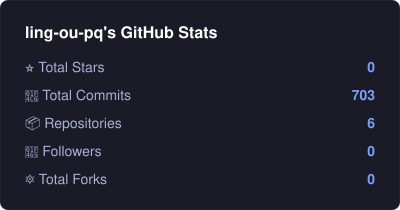
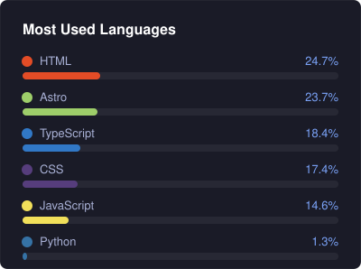

  

  &nbsp;
  

---

## 🔭 现在在做什么

- 🔬 **精读 CV 经典论文** — AlexNet → DBN → ResNet → Transformer，每篇产出中文翻译 + 大白话笔记
- 🏆 **备赛华为 ICT 大赛** — 昇腾 AI 算子开发赛道，工程实战 + 昇腾生态练兵
- 📖 **教《图像信号处理》** — 课件写到数学形态学了：PPT + 演讲稿 + MATLAB 示例 + HTML 交互可视化
- 🤖 **打磨个人 AI 工作台** — 每日记录自动生成、多仓库多平台推送、定时任务统一调度，全自动无人值守

## 🧰 我的工具箱

## 📊 数据说话

  
  

  

## 🐍 贪吃蛇 · 把贡献格一颗颗吃掉

  <picture>
    <source media="(prefers-color-scheme: dark)" srcset="https://raw.githubusercontent.com/ling-ou-pq/ling-ou-pq/output/github-snake-dark.svg" />
    <source media="(prefers-color-scheme: light)" srcset="https://raw.githubusercontent.com/ling-ou-pq/ling-ou-pq/output/github-snake.svg" />
    
  </picture>

## 📔 如实记录每一天

> [daily-log](https://github.com/ling-ou-pq/daily-log) 由本地自动化管线每日自动提交：待办、完成事项、工作台快照、多平台推送 —— 全程无人值守。

---
